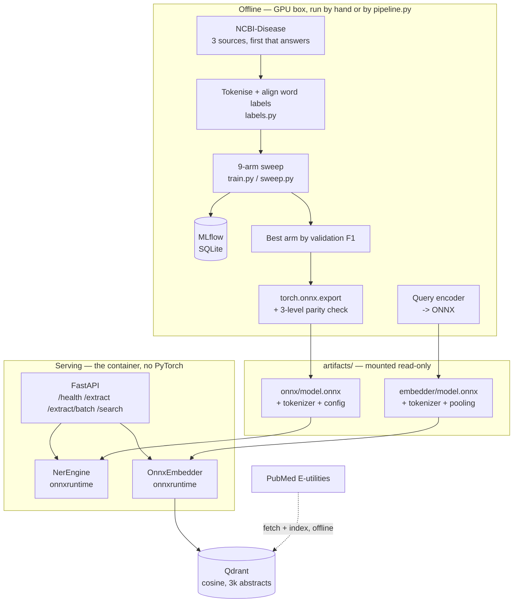
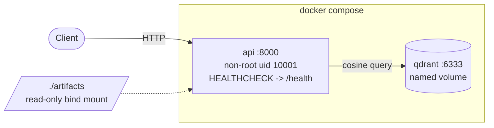
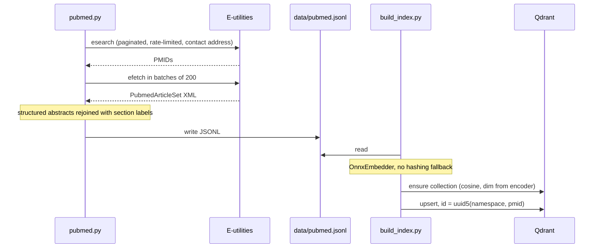

# Architecture

## The shape of it

Two halves that never run in the same process, connected by a directory of
exported artefacts.



**Why the split.** Producing the graph needs torch, datasets, mlflow and a GPU.
Running it needs onnxruntime and a tokenizer. Keeping them apart is what lets
the serving image stay small enough to be worth deploying — the PyTorch wheel
alone is larger than the entire image.

## Components

| Component | Module | Responsibility |
|---|---|---|
| Corpus loader | `data.py` | Get NCBI-Disease or BC5CDR from whichever of three sources answers; report which |
| Label alignment | `labels.py` | Project word-level BIO tags onto WordPiece subwords |
| Tokenizer loader | `tokenization.py` | Load a fast tokenizer with the casing the vocabulary actually calls for |
| Scoring | `metrics.py` | Strict entity-level IOB2 precision/recall/F1, micro and per type |
| Training | `train.py` | One run: tokenise, fine-tune, evaluate, record, save |
| Sweep | `sweep.py` | Nine arms, resilient to one failing, OOM-recovering |
| Reporting | `report.py` | MLflow → markdown comparison table |
| Export | `export_onnx.py` | Graph export plus the parity gate |
| Benchmark | `benchmark.py` | PyTorch vs ONNX latency percentiles with hardware recorded |
| Inference | `inference.py` | The one tokenise → run → decode path, shared by API, benchmark and parity |
| API | `api/` | HTTP surface, schemas, lifespan state, JSON logging |
| Retrieval | `retrieval/` | E-utilities client, embedders, Qdrant index, search |
| Orchestration | `pipeline.py` | Sequences all of the above unattended |
| README sync | `readme_sync.py` | Rewrites the four result blocks from generated output |

## Key structural decisions

**One decode path.** `inference.NerEngine` is used by the API, the benchmark
*and* the ONNX parity check. A change to span aggregation therefore cannot make
the served output disagree with the measured output — they are the same code.
This is why `check_parity` compares decoded entities and not just logits.

**Backends are a constructor argument.** `NerEngine(dir, backend="torch"|"onnx")`
tokenises identically either way and differs only in `logits()`. That is what
makes the parity check meaningful: any difference observed is the graph, not
the preprocessing.

**Degraded is a state, not a crash.** `api/state.load_state` catches model and
retrieval load failures, records the reason, and lets the process come up.
`/health` reports it; the affected endpoints return 503 with the same detail. A
container that crash-loops cannot tell you why.

**Heavy imports live inside functions.** `torch`, `datasets`, `mlflow` and
`transformers` are imported in the function that needs them, never at module
scope. The serving container has none of them installed and must still import
`medextract.api.main`.

**Provenance travels with the run.** Which corpus source answered, the split
sizes, whether the tokenizer lowercases, and the per-device/accumulation split
all go into the MLflow record. "Which F1?" is only answerable if the conditions
that produced it are attached to it.

## Request flow

### `/extract`

```
request
  -> middleware: assign X-Request-ID, start timer
  -> Pydantic validates ExtractRequest
  -> length check (413 beyond max_input_chars)
  -> NerEngine.predict_one
       tokenise with overflow windows + offset mapping
       onnxruntime forward pass
       softmax -> argmax + confidence
       decode_entities per window (BIO -> character spans)
       dedupe across windows, keep best score, sort
  -> filter by min_score
  -> ExtractResponse
  -> middleware: attach X-Request-ID, log outcome as JSON
```

### `/search`

```
request
  -> Searcher.search
       OnnxEmbedder encodes the query, mean-pools, L2-normalises
       Qdrant query_points, cosine, top_k
  -> NerEngine.predict_one on the query
  -> NerEngine.predict on all hit abstracts (one batched call)
  -> SearchResponse
```

Note the batching: hits are tagged in a single `predict` call rather than one
per hit.

## Deployment topology



Weights are mounted, not baked in. They change on a different cadence to the
code, and putting a few hundred megabytes into every image build makes each one
slow to push. The consequence is that the image is useful without them —
`/health` reports `degraded` and says what is missing.

Without Docker, `retrieval/index.build_client` accepts a filesystem path and
opens an embedded on-disk Qdrant instead, so the whole system runs from a
checkout with no daemon.

## Data flow for retrieval



Point ids derive deterministically from PMIDs, so re-running indexing updates
rather than duplicates.

## What is not here

- No queue, no async workers. Extraction is a synchronous forward pass of a
  few milliseconds; adding a broker would be more moving parts than the latency
  justifies.
- No model registry beyond MLflow's run records and an on-disk `model_dir` tag.
- No horizontal scaling story. The container is stateless apart from the
  read-only artefacts, so replicas behind a load balancer would work, but
  nothing here demonstrates it.

Further detail: [TECHNICAL_SPEC.md](TECHNICAL_SPEC.md) for the algorithms,
[DATABASE.md](DATABASE.md) for the vector store, [DEPLOYMENT.md](DEPLOYMENT.md)
for running it.
